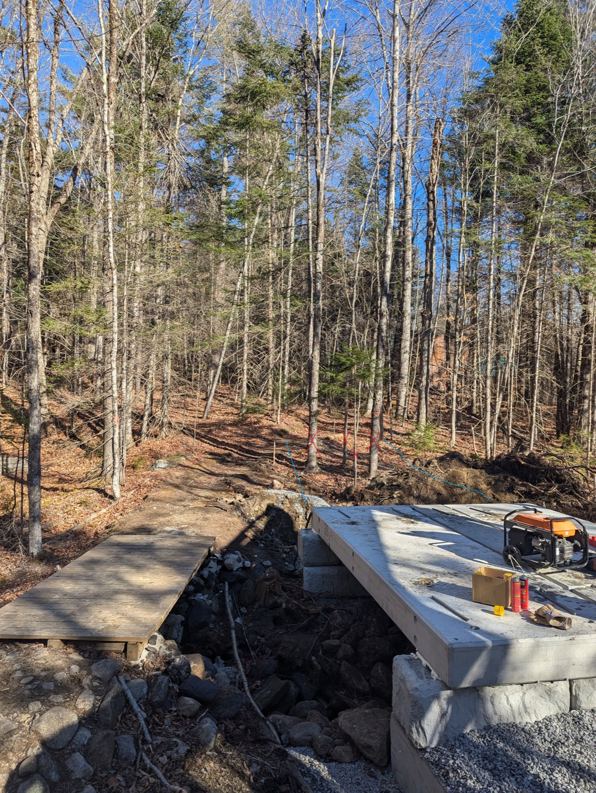
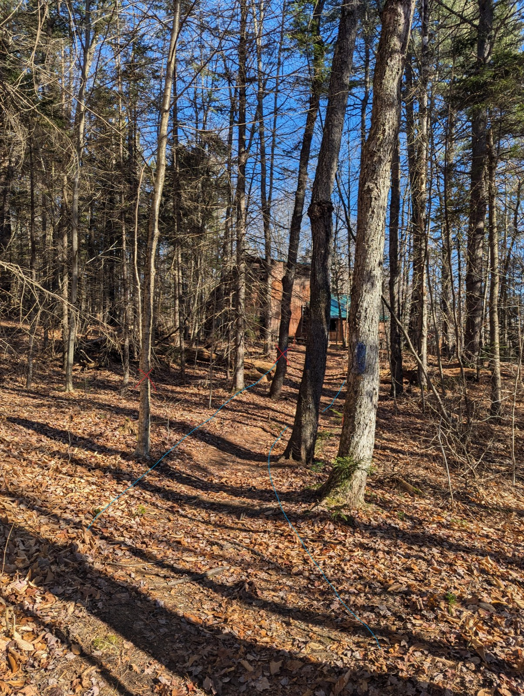

Construction began on the new parking lot, access trail, and bridge. This required removing some trees to increase the trail width so that construction and fire vehicles can access the cabin. The club was initially sad to lose the trees, but we're happy to report that the cabin still seems isolated and maintains its wilderness ethos. The parking lot has made accessing the cabin much easier, especially in the winter -- no more arriving at 11pm on a Friday to shovel out a snowbank on the side of a narrow road!

  <figure class="bunkhouse-figure">
    
    <figcaption>The new bridge's concrete deck rests on stone abutments, beside the old wooden footbridge over the brook.</figcaption>
  </figure>
  <figure class="bunkhouse-figure">
    
    <figcaption>The widened access trail winds through the autumn woods, with the Camelot cabin visible in the distance.</figcaption>
  </figure>

