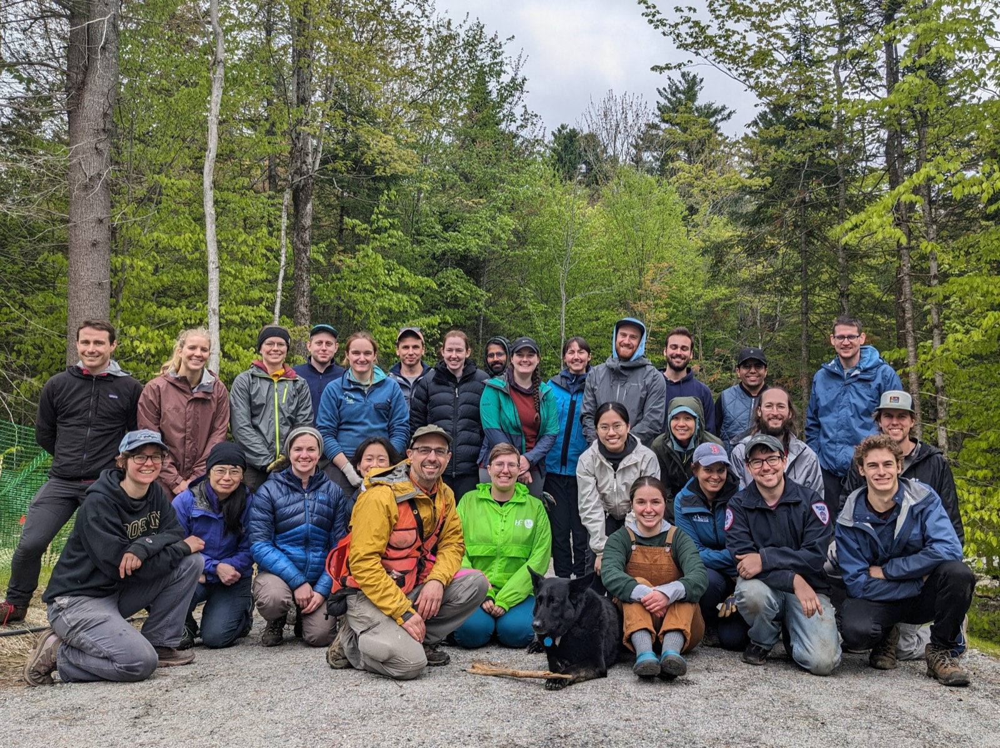
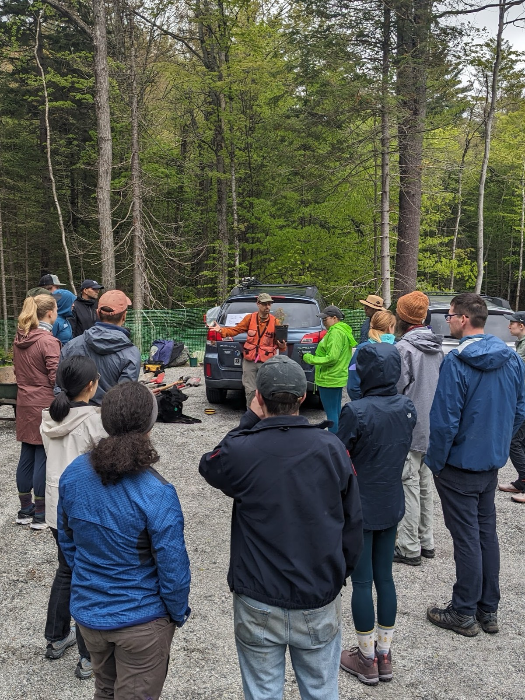
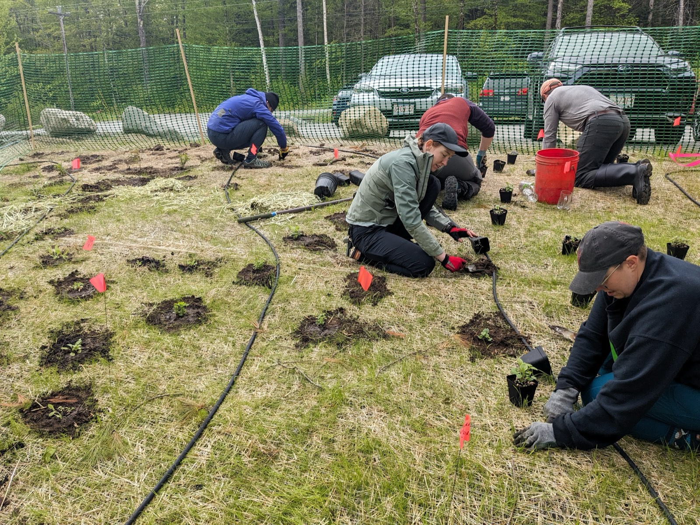
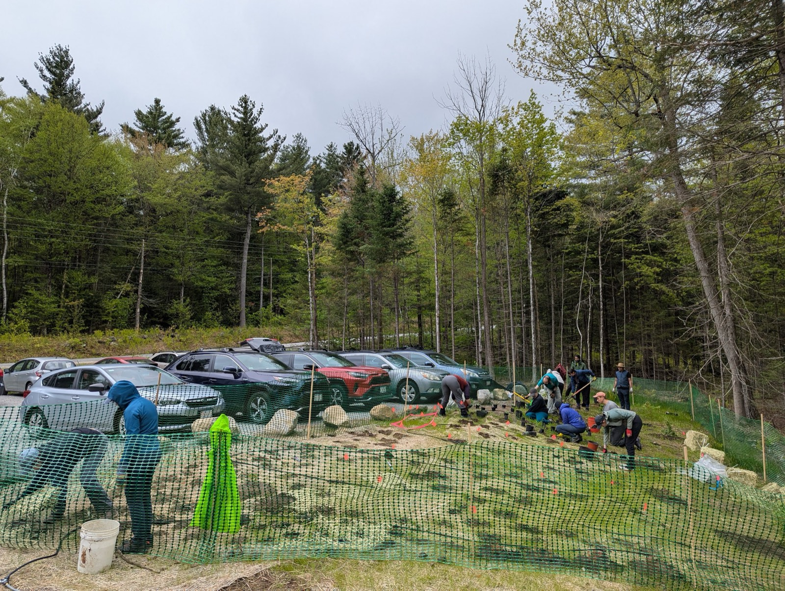

Led by the self-appointed Camelot Replanting Committee, thirty MITOCers past and present gathered at Camelot to plant wildflowers and trees around the border of the new parking lot and along the new access trail. They planted more than 200 plants! These included local shrubs and baby trees from the nursery, transplants of young trees from Camelot, as well as native pollinators that the Replanting Committee spent the winter and spring starting. The replanting was a tremendous success, and we're excited to see things get really beautiful in the coming years as root systems develop.

<figure class="bunkhouse-figure camelot-update-photo-wide">
  
  <figcaption>About thirty MITOCers (and one good dog) gathered on the new parking lot after a day of planting.</figcaption>
</figure>

  <figure class="bunkhouse-figure">
    
    <figcaption>Volunteers gather in a circle for instructions before heading out to plant.</figcaption>
  </figure>
  <figure class="bunkhouse-figure">
    
    <figcaption>Setting seedlings into the ground at flagged planting spots.</figcaption>
  </figure>

<figure class="bunkhouse-figure camelot-update-photo-wide">
  
  <figcaption>Volunteers plant the slope beside the new parking lot, behind orange safety fencing.</figcaption>
</figure>
