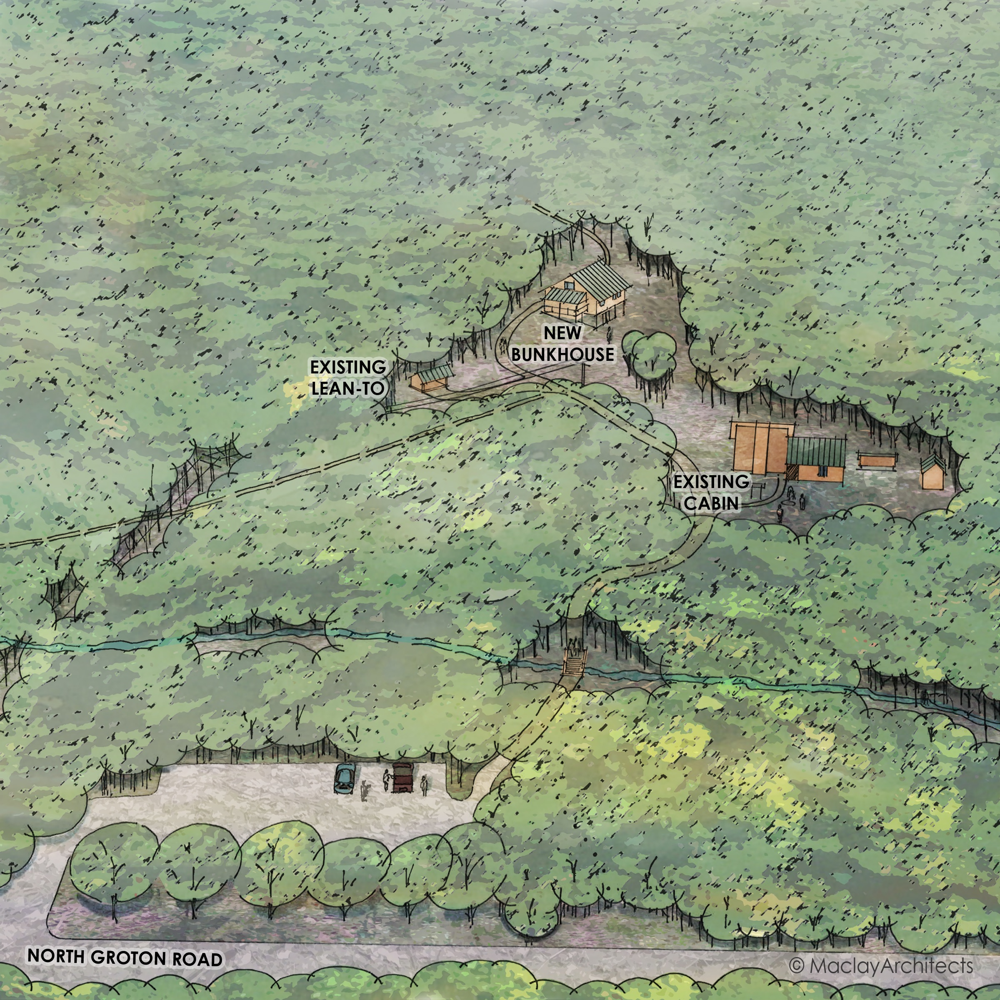
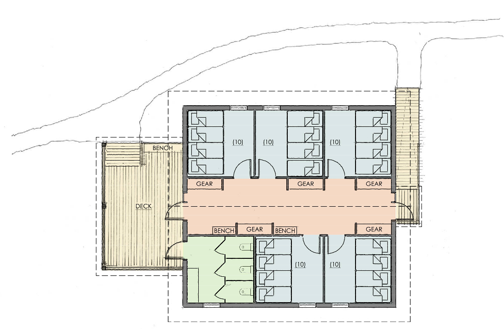
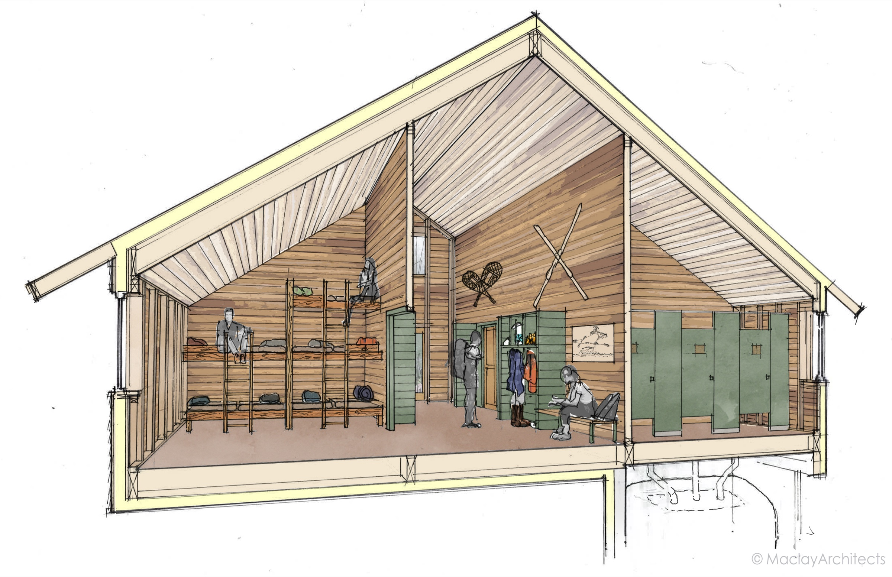
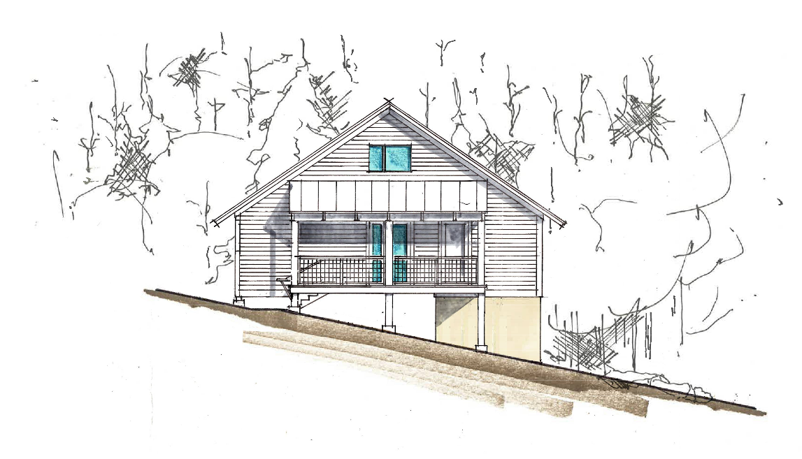

* [Location](#location-on-the-property)
* [Layout](#layout)
* [Toilets and water](#toilets-and-water)
* [Heating](#heating-and-insulation)
* [Structure](#structure)
* [Fire safety](#fire-safety)
{: .faq-jump-list}

## Location on the property

The new bunkhouse will be located behind the existing cabin, {{ site.data.bunkhouse_settings.facts.distance_to_bunkhouse }} up the hill. This is close enough that underground electrical wiring will be cost-effective, but far enough that sound from the cabin and campfire won’t carry. The bunkhouse will be farther from the property line than the existing cabin.

<figure class="bunkhouse-figure">
  
  <figcaption>Site plan, showing the parking area on North Groton Road, the footbridge over the brook, and the paths to the existing cabin, the lean-to, and the new bunkhouse.</figcaption>
</figure>

## Layout

The bunkhouse will have {{ site.data.bunkhouse_settings.facts.room_count }} sleeping rooms which accommodate {{ site.data.bunkhouse_settings.facts.room_size }} people each, so each room can hold a standard Winter School trip. A large central hallway contains ample space for gear storage for {{ site.data.bunkhouse_settings.facts.bunkhouse_capacity }} people, including hooks, cubbies, and benches. The floor plan also includes a covered deck area. In MITOC tradition, we plan to decorate the walls in part with antique MITOC rental gear such as beavertail snowshoes and old skis!

<figure class="bunkhouse-figure">
  
  <figcaption>Floor plan: {{ site.data.bunkhouse_settings.facts.room_count }} sleeping rooms of {{ site.data.bunkhouse_settings.facts.room_size }} bunks each, a central hallway with gear storage and benches, three toilets, and the covered deck.</figcaption>
</figure>

## Toilets and water

Like the existing Camelot cabin, the bunkhouse will not have running water. Three composting toilets will be accessed from the covered porch (so that they are accessible to campers even when the bunkhouse is closed). The composter beneath the toilets will be located in a small insulated basement so that it remains warm enough to compost year round.

<figure class="bunkhouse-figure">
  
  <figcaption>Cross section through a sleeping room (left), the central hallway, and the toilets (right), with the insulated basement below the toilets.</figcaption>
</figure>

## Heating and insulation

The bunkhouse will be tightly insulated and heating will not be required for most groups. Resistive electric heat will be provided to assist with initial heat-up on the coldest nights, but the energy-efficient structure means the bunkhouse won’t require much heat to stay warm once in use. Resistive heat makes sense for this application due to the infrequent demand and its high reliability and low cost.

MITOC’s current cabins (Camelot and Intervale) both require special training, in large part because of their heating (a wood stove and a finicky gas furnace, respectively). The bunkhouse’s electric heating alleviates these training and safety concerns.

## Structure

To minimize site impacts, the bunkhouse will be an above-grade structure built on piers. A small basement and a section of poured concrete wall will provide the necessary shear strength. The remainder of the bunkhouse structure will be wooden.

<figure class="bunkhouse-figure">
  
  <figcaption>Elevation, showing the covered deck, the piers, and the basement wall on the downhill side.</figcaption>
</figure>

## Fire safety

The bunkhouse will include a fire sprinkler system fed from a small cistern in the insulated basement. Sleeping rooms will be built as 1 hour rated fire enclosures, and each room will have its own direct egress window. The bunkhouse will have a networked fire alarm system. These measures ensure that the bunkhouse will comply with all modern fire safety codes.

---

Have more questions? See the [FAQs](/camelot/faqs).

Ready to help build the bunkhouse? [Donate]({{ site.data.bunkhouse_settings.donate_page }}).
